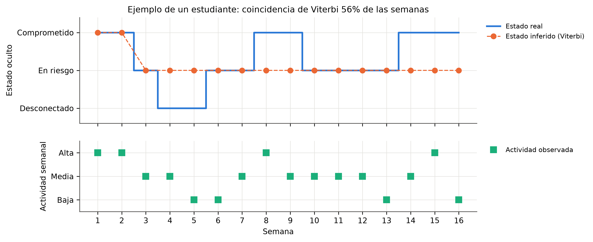
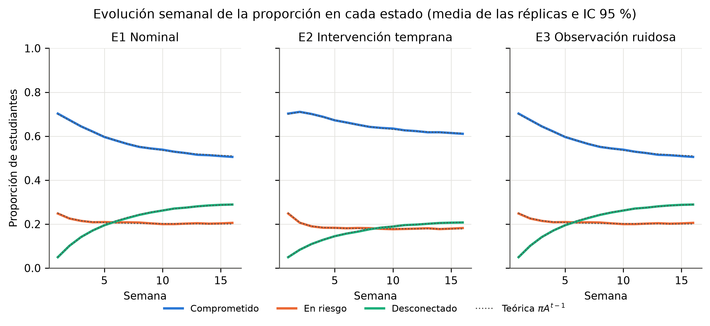
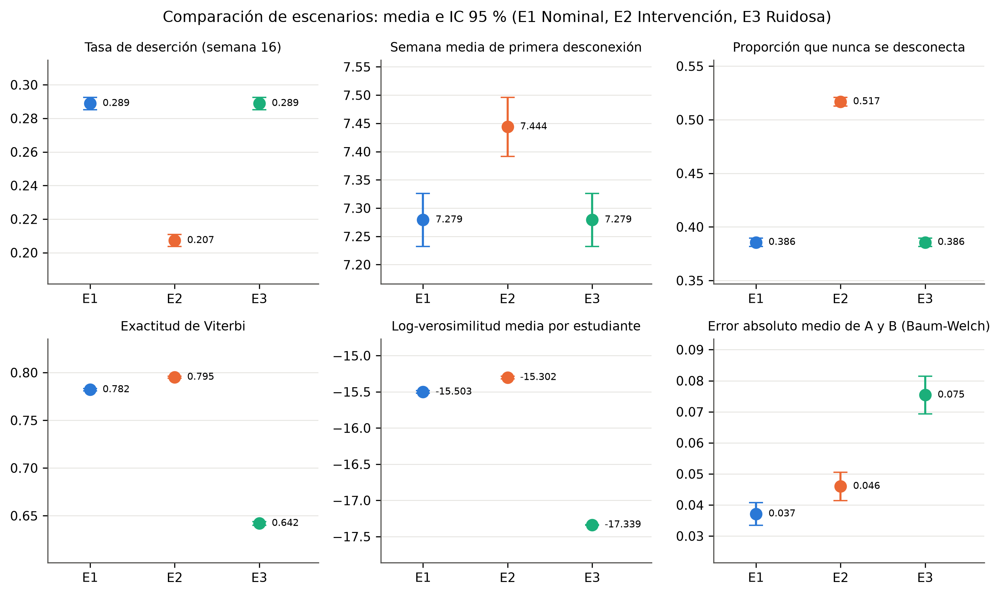
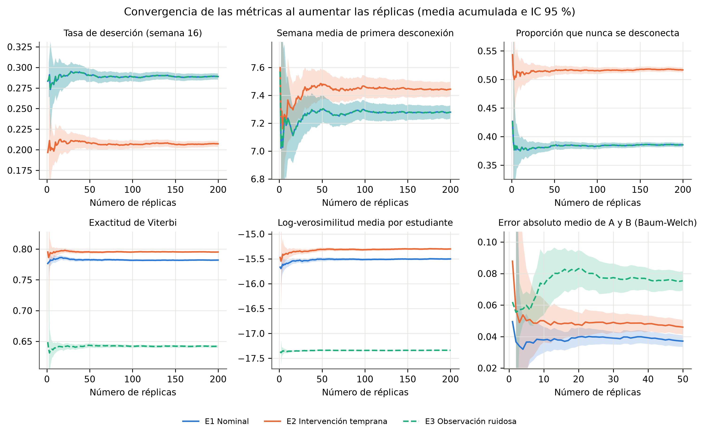
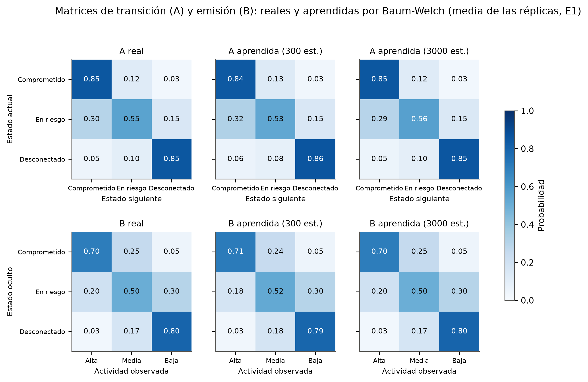
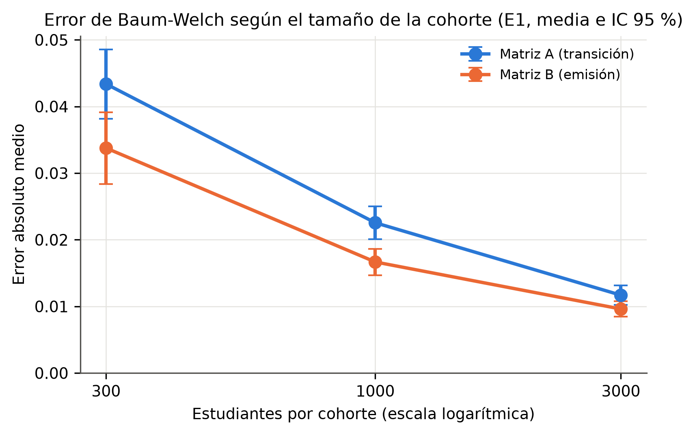
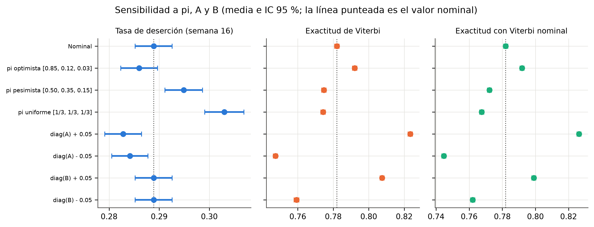
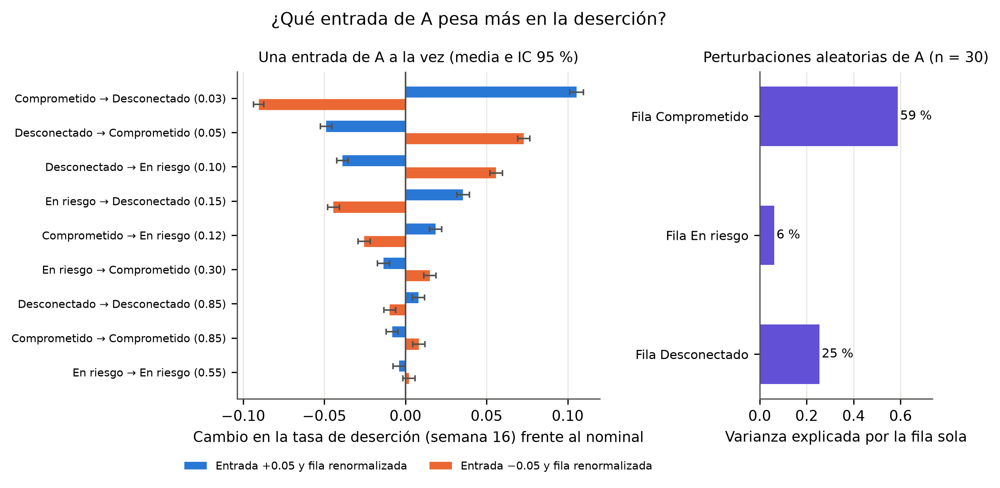
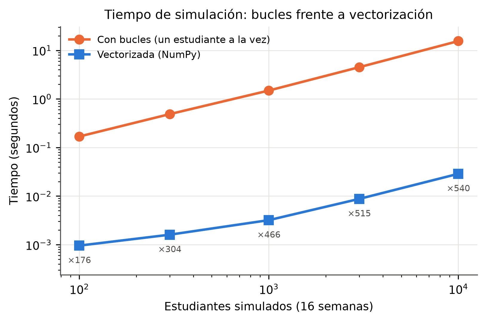

# Modelo oculto de Markov para el riesgo de deserción en educación virtual

Actividad didáctica 2-M2 del curso de Simulación, IU Digital de Antioquia (PREICA2602B020045).
Autora: Hanna Jineth Contreras Salinas. Docente: Julián Andrés Loaiza López.

Este repositorio contiene la implementación, las pruebas y los resultados de un modelo oculto de
Markov (HMM) que representa el compromiso semanal de un estudiante virtual a partir de su
actividad en la plataforma. Todos los números de este documento salen de
[`resultados/reporte.txt`](resultados/reporte.txt) y de los CSV de `resultados/datos/`.

> **Parámetros supuestos e ilustrativos.** Los valores de π, A y B no se estimaron con datos
> reales de estudiantes. Sirven para estudiar el comportamiento del modelo, no para describir una
> población concreta.

## 1. El problema y por qué es un HMM

La plataforma registra cuánta actividad tiene cada estudiante (ingresos, entregas, participación),
pero no su compromiso real. El compromiso es un **estado oculto** que cambia de una semana a otra y
que solo se manifiesta, con ruido, en la actividad **observada**. Esa es exactamente la estructura
de un HMM:

- la secuencia de estados ocultos sigue una cadena de Markov (el compromiso de la próxima semana
  depende del de esta semana);
- cada semana el estado emite una observación con una distribución que depende solo del estado.

Con el HMM se puede simular cohortes, calcular la probabilidad de una secuencia de actividad
(Forward), inferir la secuencia de estados más probable (Viterbi) y estimar los parámetros a partir
de los datos (Baum-Welch).

## 2. Modelo formal

λ = (S, V, A, B, π), con paso semanal y horizonte de 16 semanas.

- **Estados ocultos** S = {Comprometido, En riesgo, Desconectado}
- **Observaciones** V = {Alta, Media, Baja} (nivel de actividad semanal)
- **Distribución inicial** π = [0.70, 0.25, 0.05]

**Matriz de transición** A, con a_ij = P(estado j la próxima semana | estado i esta semana):

| desde \ hacia | Comprometido | En riesgo | Desconectado |
|---|---|---|---|
| Comprometido | 0.85 | 0.12 | 0.03 |
| En riesgo | 0.30 | 0.55 | 0.15 |
| Desconectado | 0.05 | 0.10 | 0.85 |

**Matriz de emisión** B, con b_j(k) = P(actividad k | estado j):

| estado \ actividad | Alta | Media | Baja |
|---|---|---|---|
| Comprometido | 0.70 | 0.25 | 0.05 |
| En riesgo | 0.20 | 0.50 | 0.30 |
| Desconectado | 0.03 | 0.17 | 0.80 |

Desconectado **no es absorbente**: cada semana un 15 % de los desconectados vuelve a otro estado,
porque en la educación virtual los estudiantes se desconectan por un tiempo y retoman. La
distribución estacionaria de A es [0.50, 0.20, 0.30].

Se usan dos definiciones de deserción:

1. **Tasa de deserción**: proporción en Desconectado en la semana 16.
2. **Primera desconexión**: semana media de la primera visita a Desconectado entre quienes se
   desconectan, y aparte la proporción que nunca se desconecta.

## 3. Instalación

Requiere Python 3.12.

```bash
git clone https://github.com/HannaSalinas/hmm-desercion-virtual.git
cd hmm-desercion-virtual
python3 -m venv .venv
source .venv/bin/activate          # En Windows: .venv\Scripts\activate
pip install -r requirements.txt
```

## 4. Uso

```bash
python -m hmm_desercion                  # experimento completo (unos 17 min con 2 núcleos)
python -m hmm_desercion --rapido         # corrida pequeña para comprobar que todo funciona (~1 min)
python -m hmm_desercion --solo-figuras   # regenera las figuras desde los CSV, sin simular
python -m hmm_desercion --salida otra/   # escribe los resultados en otra carpeta
```

Pruebas y calidad del código:

```bash
pytest -q                     # 51 pruebas
pylint hmm_desercion tests    # 10.00/10
```

Uso desde Python:

```python
import numpy as np
from hmm_desercion.escenarios import escenarios_principales

modelo = escenarios_principales()[0].modelo()            # E1 nominal
estados, actividad = modelo.simular(300, 16, np.random.default_rng(2026))
ruta, log_p = modelo.viterbi(actividad)                  # estados inferidos
log_alfa, log_verosimilitud = modelo.forward(actividad)
```

### Estructura

```
hmm_desercion/
  modelo.py        Clase HMM: validación, simulación vectorizada, Forward, Backward y Viterbi
                   en espacio logarítmico, distribución estacionaria
  baum_welch.py    Baum-Welch con Forward-Backward escalado (π fijo; se aprenden A y B)
  escenarios.py    Parámetros nominales, escenarios E1-E3 y perturbaciones
  metricas.py      Métricas de deserción, exactitud e intervalos de confianza
  experimentos.py  Semillas, réplicas, Baum-Welch por tamaño de cohorte y sensibilidad
  guia_base.py     Viterbi sin logaritmos de la plantilla, solo para compararlo
  tiempos.py       Simulación con bucles frente a vectorizada
  graficas.py      Figuras a 300 dpi
  __main__.py      Ejecución completa, CSV, figuras y reporte
tests/             Pruebas con pytest
resultados/
  datos/           CSV con datos crudos y resúmenes
  figuras/         Figuras PNG
  reporte.txt      Todos los números y las versiones del entorno
```

## 5. Reproducibilidad

- **Semilla base 2026.** `np.random.default_rng(2026)` se construye sobre `SeedSequence(2026)`; de
  ella se deriva un flujo independiente por experimento y una semilla por réplica
  (`SeedSequence(2026, spawn_key=(flujo,)).spawn(n)`).
- **Números aleatorios comunes.** Los escenarios usan las mismas semillas por réplica, así las
  diferencias entre escenarios se deben a los parámetros y no al azar. Por eso E1 y E3, que
  comparten A y π, tienen exactamente los mismos estados ocultos.
- **Versiones exactas** en `requirements.txt`: Python 3.12.3, NumPy 2.5.4, SciPy 1.18.1,
  pandas 3.1.1, Matplotlib 3.11.2, hmmlearn 0.3.3, pytest 9.2.0 y Pylint 4.1.3.
- **Validación.** El constructor de `HMM` lanza `ValueError` si A, B o π no son estocásticas.
- **Intervalos de confianza** del 95 % con t de Student y n − 1 grados de libertad.
- `hmmlearn` solo se usa en una prueba que verifica que el Baum-Welch propio da las mismas matrices.

Volver a ejecutar `python -m hmm_desercion` produce los mismos CSV, figuras y reporte. La única
excepción son los tiempos de cómputo, que dependen de la carga del equipo.

## 6. Diseño experimental

Cada escenario se simula con 200 réplicas de una cohorte de 300 estudiantes durante 16 semanas.
Baum-Welch se ajusta en las primeras 50 réplicas.

- **E1 Nominal:** parámetros de la sección 2.
- **E2 Intervención temprana:** una tutoría cambia la fila En riesgo de A a [0.45, 0.47, 0.08].
- **E3 Observación ruidosa:** B más difusa, con filas [0.50, 0.30, 0.20], [0.30, 0.40, 0.30] y
  [0.15, 0.30, 0.55].
- **Sensibilidad (P3):**
  - tres variantes de π;
  - cambios de ±0.05 en la diagonal de A y de B;
  - 30 perturbaciones aleatorias de ±0.05 de cada matriz;
  - perturbación de cada entrada de A por separado.
- **Baum-Welch por tamaño de cohorte:** 300, 1000 y 3000 estudiantes, con 50 réplicas cada uno.

## 7. Resultados principales

Media e IC 95 % (200 réplicas; Baum-Welch con 50).

| Métrica | E1 Nominal | E2 Intervención | E3 Ruidosa |
|---|---|---|---|
| Tasa de deserción (semana 16) | 0.2889 [0.2852, 0.2926] | 0.2072 [0.2037, 0.2108] | 0.2889 [0.2852, 0.2926] |
| Semana media de primera desconexión | 7.28 [7.23, 7.33] | 7.44 [7.39, 7.50] | 7.28 [7.23, 7.33] |
| Proporción que nunca se desconecta | 0.386 [0.382, 0.389] | 0.517 [0.513, 0.521] | 0.386 [0.382, 0.389] |
| Exactitud de Viterbi | 0.782 [0.781, 0.783] | 0.795 [0.794, 0.796] | 0.642 [0.640, 0.644] |
| Log-verosimilitud por estudiante | −15.50 | −15.30 | −17.34 |
| Error de Baum-Welch (A y B) | 0.037 [0.033, 0.041] | 0.046 [0.041, 0.051] | 0.075 [0.069, 0.081] |

- **Validación teórica.** La deserción simulada de E1 (0.2889) coincide con la teórica πA¹⁵
  (0.2892).
- **Intervención.** E2 reduce la deserción en un 28 % relativo y aumenta la proporción que nunca se
  desconecta de 0.386 a 0.517.
- **Ruido.** E3 tiene la misma deserción que E1, porque comparten estados ocultos. Lo que cambia es
  la observación: la exactitud de Viterbi baja de 0.78 a 0.64 y el error de Baum-Welch se duplica.
- **Desconexiones temporales.** El 61 % de los estudiantes de E1 pasa al menos una semana
  desconectado. Esa cifra incluye desconexiones temporales y no es el porcentaje que abandona.









### Baum-Welch según el tamaño de la cohorte (E1)

| Estudiantes | Error de A | Error de B | Error combinado | Iteraciones medias |
|---|---|---|---|---|
| 300 | 0.0434 | 0.0338 | 0.0386 [0.0338, 0.0434] | 317 |
| 1000 | 0.0226 | 0.0167 | 0.0196 [0.0177, 0.0215] | 238 |
| 3000 | 0.0117 | 0.0096 | 0.0106 [0.0096, 0.0117] | 234 |

Al multiplicar los datos por 10, el error se divide por 3.6, cerca del factor √10 ≈ 3.2 que se
espera si el error decrece como 1/√n.





### Sensibilidad (P3)

- **π.** Mueve sobre todo el momento de la desconexión. Con π uniforme, la primera desconexión pasa
  de la semana 7.28 a la 4.51, pero la deserción final solo sube de 0.289 a 0.303.
- **Diagonales.** Un cambio de ±0.05 en la diagonal de A deja la deserción entre 0.283 y 0.284. Los
  cambios en B no la alteran, porque la deserción depende solo de A y π, pero sí cambian la
  exactitud: 0.807 y 0.759.
- **Perturbaciones aleatorias.** Las de ±0.05 en A mueven la deserción entre 0.147 y 0.504. Las de
  B la dejan fija en 0.290.



**¿Qué entrada de A pesa más?** Cada entrada se perturbó en ±0.05 y luego se renormalizó su fila.
La deserción nominal es 0.289; la tabla muestra la deserción simulada con 200 réplicas.

| Entrada de A (valor nominal) | +0.05 | −0.05 |
|---|---|---|
| Comprometido → Desconectado (0.03) | 0.395 | 0.199 |
| Desconectado → Comprometido (0.05) | 0.240 | 0.362 |
| Desconectado → En riesgo (0.10) | 0.250 | 0.345 |
| En riesgo → Desconectado (0.15) | 0.325 | 0.245 |
| Comprometido → En riesgo (0.12) | 0.308 | 0.264 |
| En riesgo → Comprometido (0.30) | 0.276 | 0.304 |
| Diagonales (0.85, 0.55, 0.85) | entre 0.281 y 0.297 | entre 0.280 y 0.298 |

En las 30 perturbaciones aleatorias, aplicar solo el cambio de una fila reproduce esta parte de la
varianza de la deserción:

| Fila aplicada | Varianza reproducida |
|---|---|
| Comprometido | 59 % |
| Desconectado | 25 % |
| En riesgo | 6 % |

La hipótesis de que "pesan las entradas pequeñas" **se confirma solo en parte**:

- **Lo que se cumple.** Las tres entradas más influyentes son las más pequeñas.
- **Por qué casi no pesan las diagonales.** Al renormalizar la fila, su cambio efectivo es de apenas
  0.008.
- **Lo que no se cumple.** Comprometido → En riesgo (0.12) pesa menos que En riesgo → Desconectado
  (0.15).
- **Lo que comparten las entradas influyentes.** Gobiernan la entrada directa a Desconectado o la
  salida de ese estado.



### Viterbi de la plantilla y tiempos

El Viterbi de la plantilla multiplica probabilidades sin logaritmos.

- **Hasta 500 semanas** coincide con el logarítmico; para entonces la probabilidad de la mejor ruta
  ya es del orden de 10⁻²⁵⁵.
- **Desde 750 semanas** la probabilidad subdesborda a 0 y la ruta reconstruida deja de ser la
  correcta: coincide en el 91.9 % de las semanas con 750 semanas y en el 63.3 % con 5000.

La simulación vectorizada fue entre 176 y 540 veces más rápida que la versión con bucles: con
10 000 estudiantes, 0.029 s frente a 15.54 s.



## 8. Guía base: USA, MODIFICA y CREA

El curso no entregó código propio. La referencia fue el cuaderno de Colab "Punto 1 Predicción del
Clima" de otra cohorte y la plantilla LaTeX del artículo. Aquí solo se listan fallas que aparecen en
esos archivos.

**USA**

- La idea de una clase HMM con simulación y distribución estacionaria.
- El estudio de convergencia de las métricas.
- La estructura de secciones de la plantilla.

**MODIFICA** (falla encontrada → corrección)

| Falla en la guía base | Corrección en este repositorio |
|---|---|
| El cuaderno simula con `np.random.choice` global, sin semilla. | `default_rng(2026)` y una semilla derivada por réplica con `SeedSequence`. |
| El cuaderno calcula `1.96 * np.std(ddof=0) / sqrt(n)` y solo grafica esa semiamplitud; no reporta intervalos [inferior, superior] de las métricas. | IC 95 % completo con t de Student y `ddof=1` para cada métrica, en CSV y en el reporte. |
| `_validar_matrices` solo imprime advertencias, y la celda 1 redefine la clase HMM sin ninguna validación. | El constructor de `HMM` lanza `ValueError` si A, B o π no son estocásticas. |
| El análisis de convergencia vuelve a simular desde cero para cada tamaño (unas 20 100 simulaciones). | Media acumulada sobre las mismas réplicas, con bandas de IC (figura 3). |
| El punto de estabilización es la primera diferencia por debajo de un umbral (por ejemplo, "2 simulaciones" para Soleado). | Se reporta la semiamplitud del IC al aumentar las réplicas. |
| Varias conclusiones son texto escrito a mano ("~50-100", "10,000"). | Todos los números salen de los CSV y de `reporte.txt` generados por el código. |
| Caracteres basura ("的发展") en el mensaje de la distribución estacionaria y advertencias por glifos de emoji en las figuras. | Textos en español sin caracteres extraños ni emojis. |
| La plantilla trae un Viterbi sin logaritmos, que subdesborda en secuencias largas. | Viterbi en espacio logarítmico; `guia_base.py` conserva el original solo para la comparación. |
| La plantilla menciona `seed=42` y versiones de Python 3.10, y tiene expresiones matemáticas vacías. | Semilla y versiones reales, documentadas en `requirements.txt` y en el reporte. |

**CREA**

- Forward, Backward y Viterbi propios, en espacio logarítmico; el cuaderno no tiene Forward ni
  Viterbi.
- Baum-Welch con Forward-Backward escalado.
- Simulación vectorizada de muchas réplicas a la vez y la comparación de tiempos con la versión con
  bucles.
- Escenarios E1 a E3, análisis de sensibilidad (incluido el análisis por entrada de A) y Baum-Welch
  por tamaño de cohorte.
- 51 pruebas con pytest y Pylint 10/10.

## 9. Limitaciones

- **Parámetros ilustrativos.** No se estimaron con datos reales, así que las cifras absolutas
  describen el modelo y no a una población.
- **Supuestos del modelo.** Todos los estudiantes comparten los mismos parámetros, las transiciones
  no cambian durante el semestre y la actividad se resume en tres niveles.
- **Baum-Welch en condiciones ideales.** Se evaluó con el modelo bien especificado y con π fija;
  con datos reales habría error de especificación.
- **Sin estado de retiro definitivo.** Desconectado no es absorbente, así que el modelo no separa la
  desconexión temporal del abandono. Un estado "Retirado" absorbente queda como trabajo futuro.
- **Siguiente paso.** Calibrar el modelo con registros reales de una plataforma, por ejemplo el
  conjunto público de la Open University, y comparar sus predicciones con la deserción observada.

## 10. Referencias principales

1. L. R. Rabiner, "A tutorial on hidden Markov models and selected applications in speech recognition," *Proc. IEEE*, vol. 77, no. 2, pp. 257-286, 1989. doi: [10.1109/5.18626](https://doi.org/10.1109/5.18626)
2. L. E. Baum, T. Petrie, G. Soules y N. Weiss, "A maximization technique occurring in the statistical analysis of probabilistic functions of Markov chains," *Ann. Math. Statist.*, vol. 41, no. 1, pp. 164-171, 1970. doi: [10.1214/aoms/1177697196](https://doi.org/10.1214/aoms/1177697196)
3. A. Viterbi, "Error bounds for convolutional codes and an asymptotically optimum decoding algorithm," *IEEE Trans. Inf. Theory*, vol. 13, no. 2, pp. 260-269, 1967. doi: [10.1109/TIT.1967.1054010](https://doi.org/10.1109/TIT.1967.1054010)
4. M. Saqr y S. López-Pernas, "The longitudinal trajectories of online engagement over a full program," *Comput. Educ.*, vol. 175, art. 104325, 2021. doi: [10.1016/j.compedu.2021.104325](https://doi.org/10.1016/j.compedu.2021.104325)
5. M. Saqr, S. López-Pernas y L. V. D. E. Vogelsmeier, "When, how and for whom changes in engagement happen: A transition analysis of instructional variables," *Comput. Educ.*, vol. 207, art. 104934, 2023. doi: [10.1016/j.compedu.2023.104934](https://doi.org/10.1016/j.compedu.2023.104934)
6. J. Helske, S. Helske, M. Saqr, S. López-Pernas y K. Murphy, "A modern approach to transition analysis and process mining with Markov models in education," en *Learning Analytics Methods and Tutorials*, Springer, 2024, pp. 381-427. doi: [10.1007/978-3-031-54464-4_12](https://doi.org/10.1007/978-3-031-54464-4_12)
7. S. Boumi y A. E. Vela, "Quantifying the impact of student enrollment patterns on academic success using a hidden Markov model," *Appl. Sci.*, vol. 11, no. 14, art. 6453, 2021. doi: [10.3390/app11146453](https://doi.org/10.3390/app11146453)
8. H. Shi, N. Zhang, S. Caskurlu y H. Na, "Applications of machine learning for at-risk student prediction in online education: A 10-year systematic review of literature," *J. Comput. Assist. Learn.*, vol. 41, no. 4, art. e70058, 2025. doi: [10.1111/jcal.70058](https://doi.org/10.1111/jcal.70058)
9. J. Kuzilek, M. Hlosta y Z. Zdrahal, "Open University Learning Analytics dataset," *Sci. Data*, vol. 4, art. 170171, 2017. doi: [10.1038/sdata.2017.171](https://doi.org/10.1038/sdata.2017.171)

La lista completa (22 referencias) está en el artículo que acompaña la entrega.

## Video

[PENDIENTE: enlace del video]
